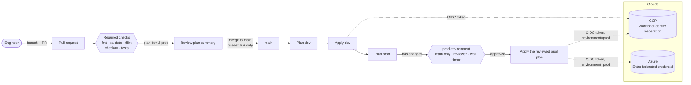

# Governed multi-cloud platform

Reusable Terraform modules and GitHub Actions workflows for delivering infrastructure and services to **Google Cloud** and **Azure** under change control: keyless authentication, reviewed plans, gated production, and policy checks on every change.

Product repositories consume these building blocks at a pinned version. This repository holds the patterns; the products and their environments stay private.

## How a change reaches production



The controls, and the risk each one removes:

| Control | Where | Removes |
|---|---|---|
| No stored cloud keys; GitHub's OIDC token is exchanged for short-lived cloud credentials | `modules/gcp-wif-bootstrap`, `terraform.yml` | Leaked or unrotated service-account keys |
| Cloud trust bound to one repository, and production to one GitHub environment | WIF attribute condition and principal | Another repo, a fork, or a feature branch deploying to prod |
| Default branch changes only through pull requests with required checks | `modules/github-environments` ruleset | Unreviewed or untested changes reaching `main` |
| Production deploys only from `main`, after approval and a wait timer | Environment protection rules | Deploys from branches; no chance to stop a bad change |
| The plan reviewed is the plan applied | Plan saved as an artifact, applied unchanged | Drift between review and apply |
| Actions pinned to commit SHAs, updated by Dependabot | All workflows | Compromised action tags |
| Policy-as-code on every change | Checkov, tflint, actionlint | Known misconfigurations shipping |
| Versioned, destroy-protected remote state | `modules/gcp-wif-bootstrap` | Lost or corrupted state |

Why each decision was made: [`docs/adr`](docs/adr).

## Contents

| Path | What it is |
|---|---|
| [`modules/gcp-wif-bootstrap`](modules/gcp-wif-bootstrap) | Layer 0 for a GCP project: APIs, state bucket, Workload Identity Federation for GitHub, deployer service account, budget |
| [`modules/github-environments`](modules/github-environments) | Repository governance as code: environments, protection rules, variables, default-branch ruleset |
| [`.github/workflows/terraform.yml`](.github/workflows/terraform.yml) | Reusable workflow: plan or apply one Terraform root on GCP or Azure with OIDC |
| [`examples/`](examples) | Minimal calling code for each module |

Planned: Azure OIDC bootstrap module, Cloud Run deploy workflow, scheduled drift detection, separate read-only plan identities.

## Using it

Pin to a commit SHA, with the release as a comment:

```hcl
module "bootstrap" {
  source = "git::https://github.com/orealvic/governed-multicloud-platform.git//modules/gcp-wif-bootstrap?ref=<sha>" # v0.1.0
  # ...
}
```

```yaml
jobs:
  plan:
    uses: orealvic/governed-multicloud-platform/.github/workflows/terraform.yml@<sha> # v0.1.0
    with:
      working-directory: infra/envs/prod
      environment: prod
      mode: plan
```

## License

Apache-2.0
