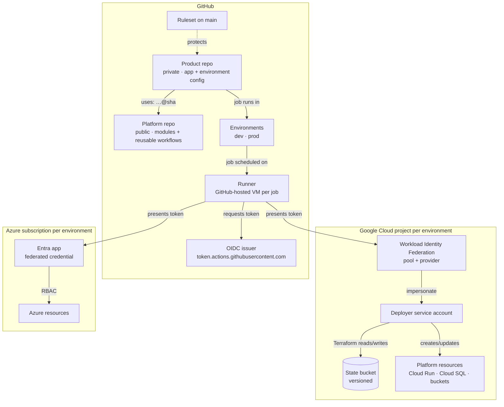

# 00 · The moving parts

Every component in this platform, what it is for, what it talks to, and the trade-off behind it. Read this first; the other guide pages zoom into individual files.

## The whole picture

Read it bottom-up as a question: *how does code in a repository end up changing a cloud resource, and what stops the wrong code from doing it?*

## Components

### On GitHub

| Component | Purpose | Talks to | Trade-off |
|---|---|---|---|
| **Platform repo** (this one) | Holds reusable building blocks: Terraform modules, reusable workflows, policy config, docs | Consumed by product repos | Public: anyone can read it, so nothing environment-specific lives here. Versioned releases mean a change here never surprises a consumer |
| **Product repo** (private) | The app and its environment configuration | Calls the platform repo's modules and workflows, pinned to a SHA | Private keeps product logic and infrastructure details away from competitors and attackers, but needs a paid plan for protection rules |
| **Ruleset** | Rules on the default branch: PRs only, required checks, no force-push or deletion | Evaluated on every push and merge | Stops unreviewed changes. Too strict (e.g. required approvals on a solo repo) and you lock yourself out; admin bypass is the escape hatch, and every bypass is logged |
| **Environment** | A named deployment target (`dev`, `prod`) holding variables and protection rules: reviewers, allowed branches, wait timer | Jobs declare `environment:`; the OIDC token then carries `environment: <name>` | The production gate. Only as strong as its rules: an unprotected `prod` environment can be used by any branch |
| **Workflow** | A YAML file in `.github/workflows/` describing jobs that run on events | Triggered by events; runs on runners | Everything is code and reviewed, but YAML is easy to get subtly wrong (see guide 01) |
| **Reusable workflow** | A workflow other workflows call with `uses:` at job level | Called by product repos | One place to fix the pipeline for every repo. Callers must pin a version, or a bad change spreads everywhere at once |
| **Runner** | The machine a job runs on. GitHub-hosted runners are fresh VMs destroyed after each job | Clones the repo, runs steps, reaches the clouds | Hosted: zero maintenance, clean every time, but on the public internet. Self-hosted: private network access and bigger machines, but you patch and secure them |
| **`GITHUB_TOKEN`** | A token GitHub gives each job to act on the repo itself (read code, comment, publish) | GitHub API | Scoped by the `permissions:` block. Default read-only here; every write permission is a deliberate choice |
| **OIDC issuer** | GitHub signs a short-lived JWT for a job that asks with `id-token: write` | The job hands the token to a cloud | The token proves *which repo, branch and environment* a job ran in. No secret is stored anywhere |
| **Dependabot** | Opens PRs to bump action SHAs and provider versions | The repo | Keeps pins current. You still review each bump, because a pin is only as safe as the version it points at |

### On Google Cloud

| Component | Purpose | Talks to | Trade-off |
|---|---|---|---|
| **Project per environment** | Isolation boundary: dev mistakes cannot touch prod | Everything below lives inside one | More projects to manage, but IAM, billing and quotas are cleanly separated |
| **Workload Identity Federation pool + provider** | Trusts GitHub's OIDC issuer and maps token claims (`repository`, `environment`, `ref`) to attributes | Receives the job's token from the runner | The provider's **attribute condition** is the first gate: tokens from any other repository are rejected before anything else happens |
| **Deployer service account** | The identity Terraform acts as | WIF grants `workloadIdentityUser` on it to a principal set | Who may impersonate it is the second gate: any job in the repo (dev) or only `environment=prod` jobs (prod). Its roles decide the blast radius if the gates fail, so keep them narrow |
| **State bucket** | Stores Terraform state for every root in the project | Terraform backend | Versioned and destroy-protected. Holds sensitive values, so access is limited to the deployer and admins |
| **Budget** | Alerts at 50/90/100% of spend, plus a forecast alert | Billing account | Alerts only; it does not stop spending |

### On Azure (Level 6)

| Component | Purpose | Trade-off |
|---|---|---|
| **Subscription per environment** | Same isolation idea as GCP projects | Management groups and Azure Policy govern them centrally |
| **Entra app registration** (or user-assigned managed identity) | The identity the pipeline acts as | App registrations live in Entra and need directory permissions to create; managed identities live in a subscription and are simpler to own |
| **Federated credential** | Trusts GitHub tokens whose subject is exactly `repo:<owner>/<repo>:environment:<env>` | One credential per environment; an exact subject match means a branch run cannot use the prod credential |
| **RBAC role assignment** | What the identity may do, scoped to a resource group or subscription | Scope to a resource group where possible |

## The sequence of one production deploy

1. You open a PR. The ruleset requires it; required checks run (`ci.yml` in this repo, tests and plans in the product repo).
2. Checks pass; you merge to `main`.
3. A workflow in the product repo starts on `push` to `main` and calls this repo's `terraform.yml` with `mode: plan` for prod.
4. The plan job declares `environment: prod` (or a separate `prod-plan` environment once plan and apply identities are split). GitHub schedules it on a fresh runner.
5. The job asks GitHub for an OIDC token. The token says, among other claims: `repository: orealvic/wedding-saas`, `ref: refs/heads/main`, `environment: prod`.
6. `google-github-actions/auth` sends the token to Google's Security Token Service. WIF checks the attribute condition (right repository), then checks the deployer's IAM policy (is `environment=prod` allowed?). If both pass, Google returns a credential valid for about an hour.
7. Terraform plans, saves the plan as an artifact, and reports whether anything changes.
8. If there are changes, the apply job waits at the `prod` environment for your approval (and any wait timer). It only runs at all because the branch is `main`.
9. You approve. The apply job gets its own token, downloads the saved plan, and applies exactly that plan.
10. The deployment appears in the environment's history: who approved, which commit, when.

## Where each control sits

| If this goes wrong… | …this stops it |
|---|---|
| A fork or another repo tries to deploy | WIF attribute condition (repository) |
| A feature branch tries to deploy to prod | Environment branch policy + prod impersonation bound to `environment=prod` |
| Someone pushes straight to `main` | Ruleset: PRs only, no force-push |
| A change with failing checks gets merged | Ruleset: required status checks |
| The reviewed plan differs from what is applied | Plan artifact applied unchanged |
| An action's tag is moved to malicious code | SHA pinning |
| A cloud key leaks | There are none to leak |
| The laptop holding state dies | Remote, versioned state |
| Terraform is asked to delete the state bucket | `prevent_destroy` |
| A misconfiguration ships | Checkov, tflint, review |

## Further reading in this guide

- [01 · How to read a workflow](01-how-to-read-a-workflow.md)
- [ADRs](../adr) for why each decision was made
